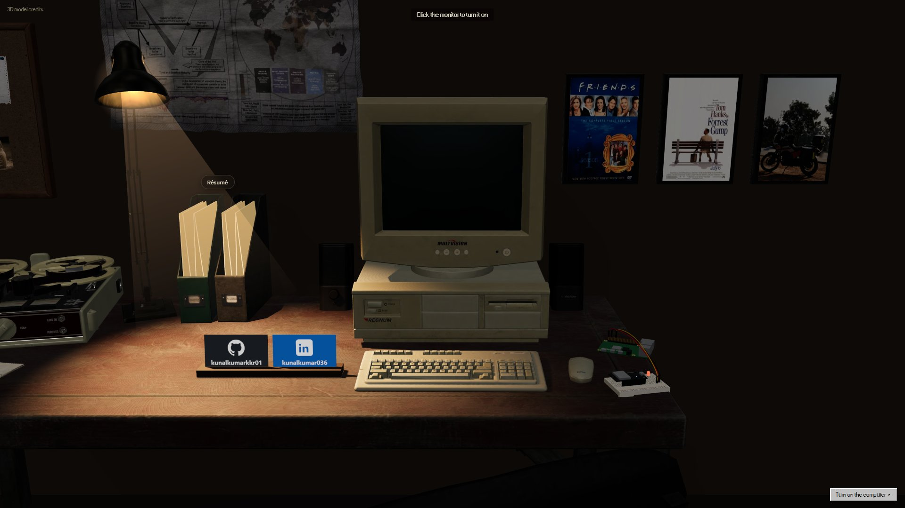
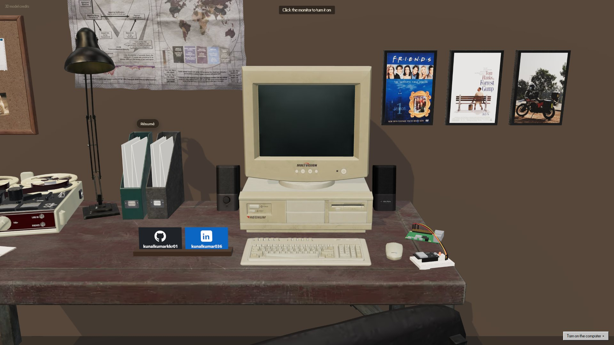
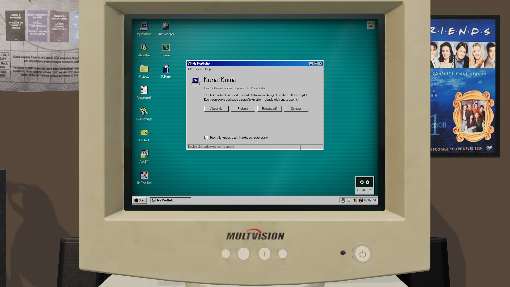
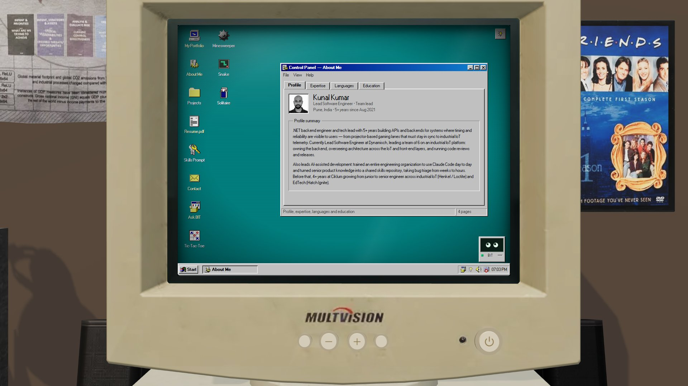
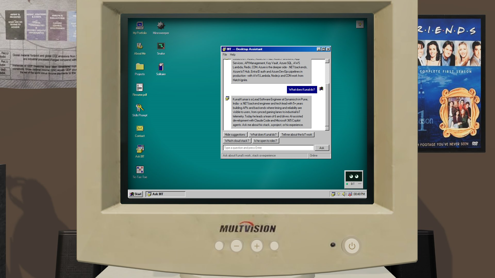

# Kunal Kumar — portfolio

A Windows 95 desktop you can actually use, standing in for a CV. Visitors land on a
3D desk with a beige CRT, keyboard, mouse and speakers; clicking the monitor flies up to
its screen and the desktop boots on the CRT's own glass. Every icon opens a real window; the four games really play.
Destination: **https://kunalkr.dev**.



## Screenshots

Captured at 1920×1080.

| | |
|---|---|
|  |  |
| **Daylight.** Click the lamp to switch between night and day. | **The desktop.** Click the monitor and the camera flies in; the desktop boots on the CRT's own glass. |
|  |  |
| **About Me.** Profile, expertise, languages and education as Control Panel tabs. | **BIT.** The desktop assistant answers questions about my work ([how it works](#how-bit-works)). |

## What's on the desk

- **The computer:** a BIOS POST of my profile, then a Windows 95-style desktop with About Me,
  Projects, Résumé.pdf, a Skills prompt, Contact and BIT, an offline assistant that answers
  questions about my work.
- **Résumé files:** the magazine files left of the monitor download or open the PDF.
- **Business cards:** GitHub and LinkedIn, one click each.
- **Speakers:** play a song, with a now-playing banner over the tape recorder.
- **Lamp:** night and day.
- **Wall:** posters and a photo of my bike; a Raspberry Pi and an ESP32 on a breadboard beside the mouse.
- **Phones:** the desk reframes for upright screens and the desktop opens in a flat CRT frame,
  with tap-friendly controls.

## How BIT works

BIT is the little monitor in the corner of the desktop; click it (or **Ask BIT**) to open its chat.
It has no AI model and no server behind it — it works offline, on any static host, with nothing to pay for
and no API key to leak.

1. **A table of topics.** `BIT_INTENTS` in `site/index.html` lists 28 topics (stack, cloud,
   the IoT platform, education, how to reach me, …). Each topic has trigger phrases and an answer.
2. **Scoring your question.** `bitReply()` lower-cases the question, strips punctuation, and checks
   which trigger phrases appear in it. Longer phrases score more, so "cloud stack" beats a bare
   "stack"; phrases of three letters or fewer must match a whole word, so "hi" doesn't fire on "hire".
   The best-scoring topic wins; ties go to the more specific topic listed first.
3. **Answers built from the same data as the windows.** Each answer is assembled from the skills,
   roles, projects and contact details the other windows show, so BIT can never contradict the desktop.
4. **Knowing its limits.** Personal questions (salary, age, address, …) get a polite pointer to the
   Contact window, and anything unmatched gets a list of things BIT can talk about.
5. **Feeling like a chat.** The answer is ready instantly; `askBot()` waits a moment (up to 0.85 s,
   longer for longer answers) so "BIT is thinking…" shows before it appears. Suggestion chips under
   the chat offer common questions with one click.

To teach BIT something new, add an entry to `BIT_INTENTS` with its trigger phrases and answer.

## Built with

Plain static files: [three.js](https://threejs.org/) for the desk, a small template runtime for
the desktop (`support.js`), and nginx in Docker to serve it. No build step, and no third-party requests —
the only other host is my own self-hosted [Umami](https://umami.is/) analytics.
3D models are CC-BY 4.0 from Sketchfab — see [credits](site/assets/models/CREDITS.md).

---

## Layout

| Path | What it is |
|------|------------|
| `site/` | **The deployable root.** Plain static files, no build step, no third-party requests. |
| `_export/` | Untouched extraction of the original design export zip. Reference only — git-ignored, never deployed. |
| `build/` | The `patch_*.py` scripts that turn the raw export into `site/`, plus `og-source.html`. |
| `Dockerfile`, `nginx.conf` | Production image: nginx serving `site/`. |

`site/index.html` is a `.dc.html` template: an HTML template plus a
`<script type="text/x-dc">` class, hydrated in the browser by `support.js`
(the "dc-runtime"). It is not a framework project — there is nothing to compile.

---

## Run it locally

```bash
cd site
python -m http.server 5173 --bind 127.0.0.1
# http://127.0.0.1:5173/
```

Or exactly as production runs it:

```bash
docker build -t kunalos .
docker run --rm -p 8080:80 kunalos
# http://localhost:8080/
```

---

## How `site/` was produced

`site/` is committed, so you never have to regenerate it. It came from
`_export/Retro Desktop Portfolio v2.dc.html` plus, in order:

| Script | What it fixes |
|--------|---------------|
| `build/patch_01_contact.py` | Routes GitHub / LinkedIn / email through one `CONTACT` block. The export shipped bare `https://github.com` links and a recipient-less `mailto:`. |
| `build/patch_02_bit.py` | Replaces the `window.claude.complete()` chat (an Artifacts-sandbox-only API that always threw here) with a scored offline intent table. |
| `build/patch_03_touch.py` | Tap-to-open icons, press-and-hold to flag a mine, an on-screen D-pad for Snake, windows that open maximised under 700px, and copy that stops saying "double-click" on a phone. |
| `build/patch_04_startmenu_touch.py` | Start submenus were unreachable on touch — the synthetic `mouseenter` before a tap opened them and the tap's own toggle closed them again. |
| `build/patch_05_notes.py` | Replaces the Writing app's "Placeholder … replace with your writing" entries with four real sample drafts. |
| `build/patch_06_resume_font.py` | Renders the résumé pages in Roboto with antialiasing re-enabled; window chrome stays pixel-perfect. |
| `build/patch_07_bit_suggestions.py` | Splits "Hide" into *Hide tips* / *Hide BIT*, and makes the chat's suggestion chips collapsible. |
| `build/patch_08_desk_games.py` | Puts the four games on the desktop, not just in Start ▸ Games. |
| `build/patch_09_snake_icon.py` | Wires in a drawn Snake icon (`make_snake_icon.py`); the pack has none. |
| `build/patch_10_solitaire.py` | Fixes the waste-click bug, adds foundation retrieval and auto-finish. See testing below. |
| `build/patch_11_edge.py` | Replaced the Links window with a four-tab Edge browser. *Edge was removed again on 2026-11-14; GitHub/LinkedIn now live in the Contact window.* |
| `build/patch_12_facts.py` | Adds the 60-fact trivia panel, each entry with a source. |
| `build/patch_13_facts_tray.py` | Adds the tray button that restores the trivia panel after Hide. |
| `build/patch_14_ttt_icon.py` | Wires in a drawn Tic-Tac-Toe icon (`make_tictactoe_icon.py`). |

Every script is idempotent and asserts each anchor matches exactly once, so a
re-run is either a clean no-op or a loud failure — never a half-applied edit.

The head of `index.html` was also rewritten by hand to add `<title>`, the
description/OG/Twitter meta, favicons, and the `window.__resources` map that
points the runtime's React and ReactDOM lookups at `site/vendor/` instead of
unpkg.

---

## Self-hosted by design

The export loaded React, ReactDOM and three webfonts from `unpkg.com` and
`fonts.gstatic.com` at page load. All of it is now vendored:

- `site/vendor/react@18.3.1` + `react-dom@18.3.1` (UMD builds, SHA-384 verified
  against the SRI hashes hard-coded in `support.js`)
- `site/vendor/three/` - three.js 0.170.0 core + `GLTFLoader` (ES modules, MIT;
  version and SHA-256 in `VERSION`), mapped by the `importmap` in `index.html`
- `site/fonts/` — MS Sans Serif regular/bold (from `98.css`) and VT323

The page makes **zero third-party requests**, which is what lets `nginx.conf`
lock the CSP to `'self'` — plus one exception, my own analytics server (below).

## Analytics

Visits and interactions are counted by a self-hosted [Umami](https://umami.is/) instance at
`analytics.kunalkr.dev` (open source, cookie-free, so no consent banner). It records page views,
country, device, browser and referrer — never who a visitor is — and these interactions:

| Event | When | Details sent |
|-------|------|--------------|
| `monitor-on` | the computer is turned on | `via`: monitor or button |
| `open-app` | a desktop window is opened (not the automatic welcome window) | `app` id |
| `bit-question` | a question is asked in BIT | `topic` it matched, or `no-match` — never the question itself |
| `resume-download` / `resume-open` | the résumé is downloaded or opened | `from`: desk or desktop |
| `profile-card` | the GitHub or LinkedIn card is clicked | `site` |
| `song-play`, `lamp-toggle`, `credits-open`, `contact-send` | the speakers, lamp, credits link, Contact → Send | `theme` for the lamp |

Events go through a small `track()` helper in `scene.js` and `index.html` that does nothing when
the script is missing (local development, ad blockers). The script only counts on `kunalkr.dev`
(`data-domains`) and respects Do Not Track. The CSP allows `analytics.kunalkr.dev` in `script-src`
and `connect-src` only.

---

## Editing content

Almost everything a visitor reads lives in class fields near the top of the
`<script type="text/x-dc">` block in `site/index.html`:

| Field | Drives |
|-------|--------|
| `CONTACT` | Contact window (incl. GitHub/LinkedIn rows), BIT's "how do I reach him" answer |
| `SKILLS` | About Me → Expertise, the résumé viewer, BIT |
| `ROLES` | Experience window, résumé page 2, BIT |
| `PROJECTS` | Projects window, BIT |
| `NOTES` | The Writing (Notepad) app |
| `BIT_INTENTS` | Every answer the assistant can give |
| `APPS`, `DESK`, `GAMES` | Which windows exist and which icons sit on the desktop |

Replace the file in `site/assets/` to swap the résumé PDF. The profile photo is
`site/assets/kunal-photo.jpg` (192 px, used in About Me and the résumé viewer).

To regenerate `site/og.png` after a copy change: serve `site/`, open
`build/og-source.html` from that origin, screenshot at 1200×630, save over
`site/og.png`.

---

## The 3D desk and the CRT frame

The page has two layers:

| Layer | Files | What it is |
|-------|-------|------------|
| 3D desk (landing) | `scene.js`, `scene-logic.js`, `vendor/three/`, `assets/models/` | three.js scene drawn over everything. Loads lazily; the "Turn on the computer" button works before it does. |
| Computer view | `index.html` (`.crt-*` CSS, `screenRefFn`, `uiScale`) | The desktop. Normally laid over the 3D monitor's glass (`html.embedded`); on screens under 700px wide or 480px tall (`EMBED_MIN_WIDTH` / `EMBED_MIN_HEIGHT`) and for `#desktop` links it sits in a 2D CSS CRT frame instead. Always mounted, so state survives trips to the desk. |

They talk through two `window` events: `kunal:enter` (scene → desktop: wake up; the
first entry plays the power-on line and boots) and `kunal:exit` (desktop → scene: the
monitor's power button or Start ▸ Shut Down). While the visitor is on the desk the
desktop ignores keys and pauses the screensaver and Snake.

- **Deep link:** `https://kunalkr.dev/#desktop` (or `?desktop`) skips the desk. If WebGL
  or a model fails, visitors land in the computer view automatically.
- **On the 3D glass:** after the fly-in the camera stops square-on to the CRT and
  `scene.js` projects the glass (`SCREEN_LOCAL`) and the model's power knob
  (`POWER_LOCAL`) to the page as CSS variables (`--es-*`, `--ep-*`); `index.html`
  positions `.crt-screen` and `.crt-power-btn` from them and hides the 2D frame.
- **UI scale:** ×1 on the 3D glass (`UI_SCALE_EMBEDDED`); in the 2D frame ×1 / ×1.25 /
  ×1.5 by viewport width (`UI_SCALE_*`). Window placement and dragging use screen units.
- **Models:** two CC-BY 4.0 Sketchfab models: "Office - Assets" (room, desk, CRT,
  computer) and "Computer Desk" (only its speakers). `stageOffice()` / `LAYOUT` in
  `scene.js` hide some props, straighten and move the computer, and hang the two posters
  plus a third, copied frame with the bike photo (`assets/frames/`). The `.glb` files were cut down to what is shown and given WebP
  textures. Credits: `assets/models/CREDITS.md` and `credits.html`.
- **Loading dialog:** while the desk loads, a Win95 "Setting up the desk" copy dialog sits in the middle
  of the screen with a block progress bar driven by the real download (`setLoadProgress()` in `scene.js`,
  `loadPercent` / `byteShare` / `blocksFor` in `scene-logic.js`). The bar holds only as many blocks as
  fit its width and the dialog is at most the screen width minus 32 px. When the server compresses the
  models it does not send their size, so `EXPECTED_MODEL_BYTES` stands in; update it when the models change.
- **Loading and speed:** the office model is split in two. `office-assets.glb` (1.3 MB, 0.6 MB gzipped)
  holds the geometry with tiny placeholder textures, so the desk appears early; `office-assets-textures.glb`
  (1 MB) holds the real textures and is swapped in by `loadFullTextures()`. Textures are 512 px except the
  computer (2048), desk, wall map, pinboard and tape recorder (1024), about 90 MB of GPU memory.
  When nothing moves the desk is drawn at 20 fps (`IDLE_FRAME_MS`); a short frame-rate probe after
  loading steps quality down on slow machines (native resolution and smaller shadows, then no shadows;
  `nextQuality()` in `scene-logic.js`). The hidden desktop's clock, trivia and BIT's eyes pause while
  the visitor is on the desk (`whenAwake()` in `index.html`). nginx gzips `.glb` (`model/gltf-binary`).
- **Posters:** the Friends cover and Forrest Gump poster are copyrighted (Warner Bros.,
  Paramount), not freely licensed; swap the files in `assets/frames/` if asked to.
  `bike.jpg` is my own photo, cropped to the frame with the number plate blurred.
- **Résumé on the desk:** `addResumePages()` stands paper sheets in the two magazine files
  left of the monitor; they pulse with a warm glow under a floating "Résumé" tag. Clicking the
  files or the tag unfolds the tag in place into *Download* / *Open ↗* (Escape or a click elsewhere
  folds it back).
- **Business cards:** `addBusinessCards()` puts a GitHub and a LinkedIn card upright in a small stand
  left of the keyboard (faces drawn at runtime by `cardTexture()`, GitHub mark from Simple Icons, CC0,
  in `assets/brand/`). Hovering a card lights a brand-coloured halo; clicking opens the
  profile. The links are in `PROFILE_CARDS` (same as `CONTACT` in `index.html`).
- **Power knob:** the model's knob is 12-sided, so `addSmoothKnob()` lays a 64-segment knob over it.
- **The song:** clicking a speaker plays AC/DC's "Shoot to Thrill" (`assets/audio/`, set in
  `NOW_PLAYING` in `scene.js`); a hovered speaker grows and thumps until the song is on. While it plays,
  a now-playing banner over the tape recorder shows the Iron Man 2 cover, title, artist, album, a
  clickable progress bar, pause and stop. The mp3 had no tags, so the details and cover came from
  Apple's iTunes Search API. The track and cover are copyrighted (not freely licensed).
- **Lamp:** clicking the desk lamp switches between a dark room lit by the lamp (glow at the shade,
  a faint beam, warm light) and daylight. A first visit opens dark; after that the visitor's choice
  is remembered (`localStorage` key `desk-theme`).
- **First desktop:** opens with the welcome window and BIT only. A click on BIT opens its chat
  (`botClick`); "Did you know?" trivia sits behind a small bulb icon in the top-right corner
  (`toggleFacts`). BIT and the trivia card stack with the windows, so anything opened later covers
  them; the taskbar tray buttons bring them back.
- **Maker bits:** a Raspberry Pi 4 and an ESP32 on a breadboard, wired together, lie right of the
  mouse. They are drawn in code (`desk-props.js`) from boxes and canvas textures, no model files.
- **On phones:** an upright screen frames the desk wider (`DESK_HALF_WIDTH_PORTRAIT`) and hides the
  chair and clipboard (`fitPortrait()`); the now-playing banner docks at the top below 700px; floating tags
  are kept on screen. In the computer view the BIOS drops the Energy Star logo and wraps each line
  (`@container (max-width:480px)`), says "Tap the screen to start up", BIT stays above the maximised
  windows, Solitaire uses smaller cards (`SOL_CARD`), and the power knob gets a 12px invisible tap margin.
  Taskbar buttons shrink to share the strip on every screen size (`TASK_BUTTON_PX`).
- **3D screen picture:** `assets/desk-screen.jpg`, a capture of the desktop shown on the
  3D monitor after the first visit.
- **CSP:** `nginx.conf` allows `blob:` in `img-src` so GLB textures can decode.

## The résumé PDF

`site/assets/Kunal_Kumar_Resume.pdf` is printed from `build/resume.html` (two A4 pages,
content from the LinkedIn profile, phone number left out on purpose). After editing it:

```bash
chrome --headless=new --no-pdf-header-footer --print-to-pdf=site/assets/Kunal_Kumar_Resume.pdf build/resume.html
```

## Testing

```bash
node build/test_crt.js             # Edge removal, profile content, CRT frame, UI scale, geometry, desk/computer bridge, quiet desktop on the desk
node build/test_scene_logic.mjs    # entry mode, view state machine, easing, song time, banner clamp, lamp theme, render pacing, quality steps
node build/test_solitaire.js       # Solitaire rules (below)
bash build/smoke_test.sh           # against a running image: status codes, caching, security headers, .glb gzip
```

`build/dc_harness.js` loads the shipped dc-script for the first one, the same way the
Solitaire test does.

`node build/test_solitaire.js [seed]` extracts the shipped
`<script type="text/x-dc">` and exercises the real game logic headless, so the
test cannot drift from the code. 1037 assertions: deal integrity, the draw and
recycle cycle, every tableau and foundation rule, card conservation and
face-up-run validity across 60 seeded games, and that games are genuinely
winnable (18/60 with a naive strategy plus auto-finish). Pass a seed to
reproduce a failure exactly.

## Deploying

`main` is production. Every change reaches it through a pull request:

```
branch → pull request → CI (Tests + Docker build) → squash merge → Dokploy redeploys kunalkr.dev
```

1. Branch off `main`, commit, push, open a pull request.
2. **CI** (`.github/workflows/ci.yml`) runs the three test suites and builds the production
   image, starts it and runs `build/smoke_test.sh` against it.
3. When both checks are green, squash-merge. Dokploy's GitHub App sees the push to `main`,
   rebuilds the image from the `Dockerfile` and swaps the container in.

**Rules on `main`** (ruleset "Protect main"): changes only through pull requests; both CI
checks must pass on a branch that is up to date with `main`; review conversations must be
resolved; squash merges only, so history stays linear; no force-pushes, no deletion, no
bypass. Dependabot opens weekly pull requests for the nginx image and the CI actions.

**Caching:** files that keep their name when they change (the page, `scene.js`, models,
the résumé, photos) are sent with `Cache-Control: no-cache`, so a deploy is visible on the
next visit and an unchanged file costs only a 304. Icons named by their content hash are
cached for a year; vendored libraries and fonts for a week.

**Dokploy setup** (already done for kunalkr.dev; for a fresh server): new project →
Application, source **GitHub** (the Dokploy GitHub App), branch `main`, build type
`Dockerfile`, **Autodeploy** on, container port **80**, domains `kunalkr.dev` and
`www.kunalkr.dev` with certificate **letsencrypt**.

### ⚠️ Cloudflare and the certificate

`kunalkr.dev` is registered through Cloudflare, and Traefik issues its
certificate over ACME **HTTP-01** — which needs to reach *this* origin, not
Cloudflare's edge.

- Point `kunalkr.dev` (and `www`) at your server's public IP.
- Set the record to **DNS only (grey cloud)** before the first deploy, or
  HTTP-01 validation fails and Traefik falls back to a self-signed certificate.
- Once the padlock is green you may switch the proxy back on, but only with
  Cloudflare SSL mode **Full (strict)**. "Flexible" will loop against Traefik's
  HTTPS redirect.

### After deploying, check

- [ ] `https://kunalkr.dev` shows the 3D desk, padlock valid; clicking the monitor
      flies in and boots; the monitor's power button flies back out
- [ ] DevTools → Network shows no request off `kunalkr.dev` except `analytics.kunalkr.dev`
- [ ] Resume.pdf's *Save As...* downloads the PDF
- [ ] Contact → Send opens a mail client addressed to the real address
- [ ] Contact window's GitHub and LinkedIn rows open the real profiles
- [ ] On a real phone: icons open on one tap, Start ▸ Games works, Snake's D-pad
      steers, and press-and-hold flags a mine

---

## Known gaps

- **The Writing app's four posts are samples, not published writing.** They are
  real technical notes on IoT Hub replays, telemetry table shape, SignalR
  fan-out and Functions vs Container Apps, and the window stamps each one
  "· draft" — but they go out under your name, so read them before deploying and
  swap in your own where you would say it differently.
- **The email address is a plain `mailto:`** in the page source, so scrapers will
  find it. That is the normal trade-off for a portfolio; swap in a form service
  if it becomes a problem.
- **Accessibility is weak.** Desktop icons and window controls are unlabelled
  `div`s and `button`s in the accessibility tree, and the whole thing needs a
  pointer. It is a visual toy first.
- **The 3D desk needs WebGL** and a mouse/touch; keyboard users get the
  "Turn on the computer" button instead.
